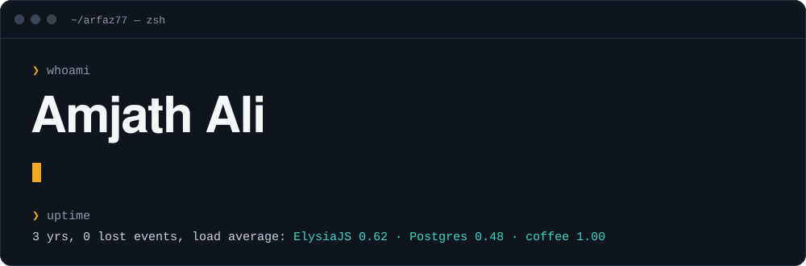
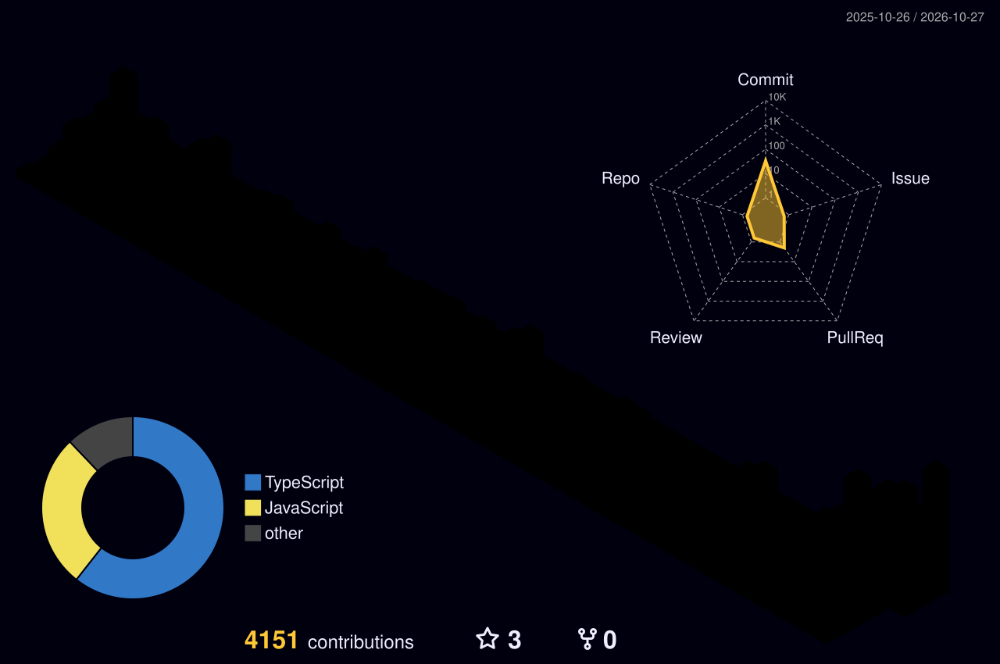

<p align="center">
  
</p>

<p align="center">
  <a href="https://linkedin.com/in/amjad-ali-6350a3248"></a>
  <a href="mailto:amjadalipaduppu@gmail.com"></a>
  
</p>

```console
❯ cat about.txt
Civil engineer by degree, backend architect by obsession.
3+ years shipping TypeScript in production — ERP/CRM platforms, workflow engines,
outbox queues and the dashboards that sit on top of them.
```

### `// metrics that shipped`


### `// how I build` — one event, start to finish



### `// career.outbox` — click an event to replay it

<details open>
<summary><b>🟢 RUNNING &nbsp;·&nbsp; Full-Stack Developer · Indian Edu Hub</b> &nbsp;<code>2025-02 → now</code></summary>

```diff
+ Solo-architected a role-based ERP/CRM unifying HR, Sales & Admissions
+ Metadata-driven entity runtime: new business objects by config, not code
+ Workflow engine on outbox pattern + PBAC + SKIP LOCKED queues
+ Event-driven backend on Express.js + ElysiaJS with clear domain boundaries
+ Meta CAPI server-side: 90% data coverage, 9.4 Event Match Quality
+ Rescued a corrupted droplet with zero data loss, then moved to Vercel
```
</details>

<details>
<summary><b>✔ COMMITTED &nbsp;·&nbsp; Full-Stack Developer · Autobse</b> &nbsp;<code>2023-12 → 2025-01</code></summary>

```diff
+ Built the web platform + admin panel in Next.js
+ Migrated REST to GraphQL; real-time via subscriptions & WebSockets
+ Code splitting + lazy loading for 1.8× responsiveness
+ Reusable UI + logic layers cut new-feature time by 60%
```
</details>

<details>
<summary><b>✔ COMMITTED &nbsp;·&nbsp; Web Developer Intern · Technewings</b> &nbsp;<code>2023-05 → 2023-11</code></summary>

```diff
+ NFC-enabled digital business card generator in React
+ Third-party REST integrations + automated test suites
```
</details>

### `// try a command` — click to run

<details>
<summary><code>❯ git log --oneline</code></summary>

```console
a1c3e7f  refactor: swapped load-bearing walls for load-balanced services
5b9d201  feat: speaks English, Malayalam, Hindi and fluent EXPLAIN ANALYZE
e04f88a  fix: rescued a dead server at 2am, lost 0 rows
9f2a6c4  chore: open to interesting backend + platform problems
```
</details>

<details>
<summary><code>❯ git status</code></summary>

```console
On branch main
Your career is ahead of 'origin/civil-engineering' by 3 years.

Changes being built:
  modified:   scalestack/
  modified:   business-os/
  new file:   ai-agent-layer/
```
</details>

<details>
<summary><code>❯ git blame skills</code></summary>

```console
3y  TypeScript, Next.js, Bun, Hono, ElysiaJS
3y  PostgreSQL, MongoDB, Redis, query tuning
2y  Outbox pattern, RBAC/PBAC, workflow engines
1y  LLM/RAG, agent tool orchestration, n8n
```
</details>

<details>
<summary><code>❯ git branch -a</code></summary>

```console
* main (full-stack)
  feature/ai-agents
  feature/scalestack
  remotes/origin/civil-engineering  (archived)
```
</details>

<details>
<summary><code>❯ git checkout -b hire-me</code></summary>

```console
Switched to a new branch 'hire-me'
→ amjadalipaduppu@gmail.com
→ linkedin.com/in/amjad-ali-6350a3248
```
</details>

### `// currently building`

| **ScaleStack** · `22 tables` | **Business OS** · `21 modules` |
|---|---|
| Multi-tenant project management + live org chat. Auth and IDOR-safe ACL ship before a single chat message does. | Modular ERP framework. Pipeline → Lifecycle → State → Outcome workflows, JSONB custom fields, one identity model for everything. |
| `Hono` `PostgreSQL` `Drizzle` `TanStack Start` `Better Auth` | `RBAC/PBAC` `JSONB` `soft-delete governance` |

> **WIP** — an AI agent layer: one chat, intent routed to tool packs, every write gated behind an approval flow.

### `// stack — package.json`

```json
{
  "frontend": ["next", "react", "typescript", "tailwindcss", "tanstack-start", "zustand"],
  "backend":  ["bun", "hono", "elysia", "express", "graphql", "websockets"],
  "data":     ["postgresql", "mongodb", "redis", "drizzle-orm"],
  "patterns": ["outbox", "event-driven", "rbac/pbac", "ddd", "workflow-engines"],
  "ai":       ["llm/rag", "agent-tool-orchestration", "n8n"],
  "ops":      ["docker", "nginx", "aws", "vercel", "github-actions"]
}
```

<p align="center">
  
</p>

### `// contributions — as a city`

<picture>
  <source media="(prefers-color-scheme: dark)" srcset="./profile-3d-contrib/profile-night-rainbow.svg">
  <source media="(prefers-color-scheme: light)" srcset="./profile-3d-contrib/profile-green-animate.svg">
  
</picture>

<p align="center">
  
  
</p>

<p align="center"><code>— exit 0 —</code></p>
